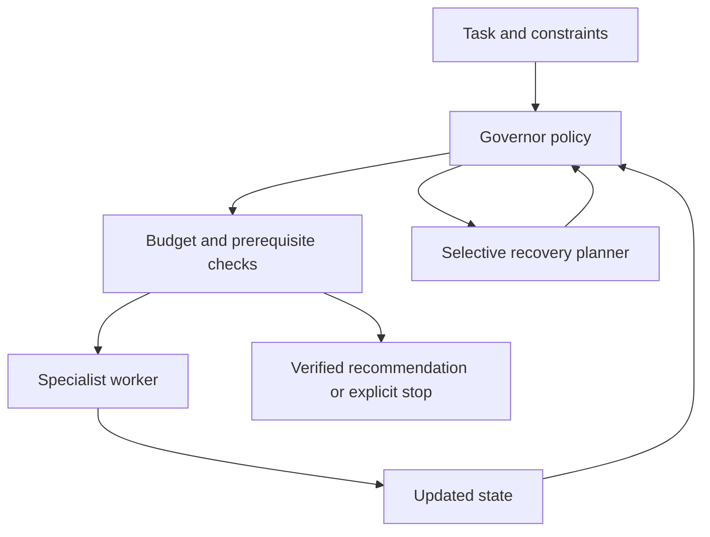

# FRIDAY Cortex v1

**GitHub publication:** [start from a checkout, evidence labels and privacy exclusions](docs/github_publication.md).
Public hosting is **not deployed**. This repository includes source, tests and
reviewed submission assets; raw runs, private checkpoints and prebuilt releases
are retained locally and excluded from Git.
Publication checks: **260 tests passed** from a clean public-file export. One
existing regression test now uses synthetic currency fixtures in place of private
run files; its rejection checks are preserved. Application source is unchanged.

**Submission release:** [installation, public-mode limits and missing hosting setup](docs/public_submission_v1.md).
The 0.2.0 wheel is built reproducibly and started from a clean isolated installation.
The public default supports real supplier execution and server-console reminders;
AI/document drafting is unavailable until a permitted backend is reachable.
No public deployment or container build validation is claimed.
Submission script, description, screenshots and thumbnail are in `submission/public_submission_v1/`.

A runnable Python foundation for a budget-aware hybrid governor. Its first
application compares supplier quotes under quantity, total-cost and delivery
constraints. It chooses admissible worker actions, verifies results, recovers
from bounded failures, and records an execution trace.

**Status:** a browser execution desk now runs the durable engine with plan preview,
session-owned jobs/files, verification traces, reminders and reviewed owner Git actions.
Start with `python -m cortex web` and open its printed owner URL. See
[browser setup and hosting](docs/browser_product_v1.md) and
[the frozen real-tools checkpoint](docs/real_tools_v1.md),
[the durable checkpoint and commands](docs/durable_refinement_v1.md),
[the planning checkpoint and commands](docs/structured_planning_v1.md) and
[the preserved product foundation](docs/product_foundation_v1.md). The existing
supplier research scaffold is preserved. Offline workers and policies are deterministic. Optional Jev and
Ollama controllers make real model requests only when explicitly selected.
The executor constrains their decisions. This is a collection of specialist
worker roles, not a collection of independently autonomous LLM agents. The
optional Ollama extraction worker proposes source-backed fields; it does not
calculate totals or make the final recommendation.

## Request interface

Planning is opt-in to preserve the foundation comparison path. A single known
supplier task can construct and execute a plan without model calls:

```powershell
python -m cortex request "Compare suppliers" --task examples/supplier_task.json --planning auto --offline --max-model-calls 0 --output runs/my_first_plan.json
```

Use `--planning always` to invoke the configured planner, or `--plan-file` to
validate and execute a supplied plan. Plans and dependency outputs are bounded;
unsupported external actions stop explicitly. Planning v1 had 175 passing tests;
ordinary JSON traces remain exports. Add `--durable` to save resumable job state:

```powershell
python -m cortex request "Compare suppliers" --task examples/supplier_task.json --durable --offline --max-model-calls 0 --output runs/my_durable_job.json
python -m cortex job inspect JOB_ID
python -m cortex job resume JOB_ID --output runs/my_resumed_job.json
```

Resume retains spent budgets and accepted outputs. It rejects changed inputs,
model configuration or source code. Unknown in-flight calls retain their charge;
replacement requires `--retry-interrupted` and may duplicate server work.
Declared word/section/currency checks can request at most two repairs. Passing
them does not establish general factual correctness. See the checkpoint guide
for runnable pause/resume examples, mocked successes and preserved live failures.

From this checkout, try the new classifier → router → supplier worker path:

```powershell
python -m cortex request "Compare suppliers" --task examples/supplier_task.json --offline --max-model-calls 0 --output runs/my_first_request.json
```

Expected: **Beta**, **11500**, four synthetic work units, zero model calls.
Choose a fresh output filename each time. The original commands below remain
available. Configuration is in `config/cortex.example.json`; cloud keys are read
only from environment variables. The preserved foundation had 143 passing tests and
separately documented live Ollama and mocked cloud-provider evidence.

## Run without installation or API keys

Requires Python 3.10 or newer. No third-party runtime dependencies.
Extract the archive and open a terminal inside `cortex-v1`.

```powershell
python -m cortex examples/supplier_task.json
python -m cortex examples/supplier_task.json --fault bad_arithmetic
python -m cortex examples/csv_task.json
python -m cortex examples/missing_shipping.json
python -m unittest discover -s tests -v
python -m cortex.benchmark --count 100 --output runs/benchmark.json
```

Expected standard result: **Beta**, total **11500**. Alpha has the cheaper unit
price but costs 12500 after shipping. Gamma costs 9300 but arrives too late.
All values use one unspecified task-wide currency. A missing shipping cost
produces `needs_clarification`, not a guessed zero.

Try a tight budget:

```powershell
python -m cortex examples/supplier_task.json --max-units 3
```

It must stop before recommending rather than skip a required checkpoint.
Exit code 0 means completed, correctly found no feasible supplier, or requested
clarification. Exit code 2 means interrupted, failed, or budget-limited.

## Optional live Ollama controller

Use an already-installed **local** model shown by `ollama list`; model names
below are placeholders, not model download instructions. Keep Ollama running.
No model download is performed by Cortex.

```powershell
python -m cortex examples/csv_task.json --policy ollama --model YOUR_LOCAL_MODEL --planner-model YOUR_STRONGER_LOCAL_MODEL --output runs/ollama.json
```

`--planner-model` is optional for an Ollama controller; it otherwise uses the
same model for recovery planning. `--ollama-url` defaults to localhost:11434.
Requests use a JSON schema, temperature 0, a 256-generation-token setting and
`think: false`. Model/server enforcement may vary. Ollama Cloud structured
outputs are not supported by the provider's current documentation, so this
adapter is intended for local models.

Only source data needed for recovery goes to the planner. Routine controller
state contains progress, errors, admissible actions and remaining work budget,
not the full quotes or transcript.

### Selective Ollama mode

```powershell
python -m cortex examples/supplier_task.json --policy ollama --model qwen2.5:0.5b --selective --max-model-calls 0 --output runs/my_selective_normal_v1.json
```

One focused concept: **a forced next step does not need a model decision**.
After budget filtering, if exactly one action other than `stop` is available,
code selects it. For a normal task this is extract → calculate → verify →
recommend: four synthetic work units and zero model calls/tokens. When several
non-stop actions remain, Ollama chooses among the admissible actions, including
`stop`. If only `stop` remains, the engine stops without a model request.
Planner decisions use the same selective rule over their own affordable options.

`--selective` requires `--policy ollama`. Omit it to keep the ordinary controller
comparison, which asks the model for each workflow decision. Rule decisions can
continue after the model-call cap is reached; an ambiguous decision must stop
at that cap. Provider failures stop explicitly in both controller and planner
roles. Selective invocation does not guarantee a good model decision.

Each new CLI output records its configuration, code checkpoint, source/input
SHA-256 hashes, Python version and UTC recording time. Traces distinguish rule
and model decisions; usage records distinguish controller and planner calls.
`--output` refuses an existing file, so choose a new filename for each run.
See `EXPERIMENT_LOG.md` for the October 8 selective checkpoint and limitations.

### Failure-aware recovery baseline

```powershell
python -m cortex examples/supplier_task.json --policy ollama --model qwen2.5:0.5b --selective --recovery-mode failure-aware --fault extract_timeout --max-model-calls 0 --output runs/my_failure_aware_timeout_v1.json
```

Choose `--recovery-mode failure-aware` with `--policy local` for offline use,
or with `--policy ollama --selective` to retain a model planner for unknown
failures. Omitting this option preserves the original selective behavior.

The focused distinction is the **cause of failure**:

- **Transient execution failure:** extraction raised `TimeoutError`. Retry
  that extraction operation once, preserving its strict/flexible parser setting.
  A second timeout ends with `retry_limit`; it does not ask for missing data.
- **Parsing problem:** the fast parser requires format/alias handling. Run
  the existing CSV/alias parser once as `repair_extract`.
- **Missing information:** `MissingFieldsError` remains after alias handling.
  Ask for clarification; missing shipping is never guessed as zero.

Categories come from exception types, parsing-stage flags and verification
codes, never from exception-message matching. Arithmetic mismatches still get
one recalculation and another verification; a repeated mismatch ends with
`recovery_limit`. Source-integrity mismatches retain bounded flexible extraction
repair. Unclassified/unsupported failures retain a bounded planner path.
Known rules and all workers are deterministic Python, not a learned recovery
policy. HTTP provider failures consume an attempt and stop explicitly, with no
API retries or fallback.

`retry_extract` has synthetic weight 1; `repair_extract` has weight 2. All
actions still obey work limits, shared controller/planner call limits and the
20-transition bound. Traces include `decision_failure_category` (the cause
known when choosing), `failure_category` (observed failure, or the cause being
handled), `decision_source` (`rule`/`model`), and planner decision source.
The `extract_timeout_persistent` fault exercises the retry limit.

Reproduce paired checks with fresh directories:

```powershell
python scripts/compare_recovery.py --execution mocked --output-dir runs/my_recovery_mocked_v1
python scripts/compare_recovery.py --execution live --model qwen2.5:0.5b --output-dir runs/my_recovery_live_v1
python scripts/verify_selective_baseline.py
```

Mock token counts are artificial fixtures, separately labeled from live
provider counts. Each comparison uses identical inputs and budget caps across
modes. The five fixtures have known deterministic routes; reported avoidable
interventions use that fixture-specific definition, not a general cost oracle.
The checkpoint details and limitations are appended to `EXPERIMENT_LOG.md`.

### Heterogeneous extraction workers

One focused concept: **worker selection and workflow control are separate**.
The governor chooses when to extract, calculate or verify. The extraction
router chooses how to read the quote source. Python still performs all
arithmetic, feasibility checks and recommendation ordering.

| Extraction mode | Worker selection |
| --- | --- |
| `parser` (default) | Existing deterministic JSON/CSV/alias parser |
| `llm` | Separately configured Ollama extraction model |
| `parser-first` | Parser for JSON/CSV; Ollama for bounded plain text |

```powershell
python -m cortex examples/plain_text_quotes.json --policy local --recovery-mode failure-aware --extraction-mode parser-first --extractor-model qwen2.5:7b-instruct --max-model-calls 1 --output runs/my_plain_text_extraction_v1.json
```

`--extractor-model` is independent of controller `--model` and
`--planner-model`. A local governor can use a model worker. An Ollama governor
can use a parser worker. All three model roles share `--max-model-calls`.
Provider failures consume an attempt and stop explicitly, without automatic
API retries or local fallback. Invalid extraction asks for clarification.

Supported plain text is at most 12000 UTF-8 bytes and eight quotes, in
paragraphs headed `Supplier NAME:`. Use explicit unit price, shipping per
order (or freight), available stock and delivery days. `Note:` paragraphs are
ignored as data distractions; no source directions are executed. This is a
bounded development interface, not an arbitrary document reader.

Model output contains five fields, exact excerpts and unresolved issues.
Missing shipping stays `null`; zero requires explicit supporting data.
Python validates types, nonnegative values, source excerpt occurrence,
supplier attribution, labeled values and supported business scope. Conflicts,
missing values or unsupported terms require clarification before calculation.
Structured model extractions are also compared with the existing parser.
Excerpt presence and these checks do **not** prove semantic interpretation or
source authenticity; model confidence is neither requested nor accepted.

Each trace records worker identity/model, prompt version, extraction provenance
and verification results. `worker_execution_source` describes the worker;
`decision_source` describes the governor decision. `model_usage` includes all
three roles, and `worker_model_usage` isolates worker calls. Token totals are
provider-reported; unknown failed-request usage stays `null`. Worker and engine
latency are measured separately from synthetic action weights.

Run the independent eight-case development comparison in fresh directories:

```powershell
python scripts/compare_extraction.py --execution mocked --output-dir runs/my_extraction_mocked_v1
python scripts/compare_extraction.py --execution live --extractor-model qwen2.5:7b-instruct --output-dir runs/my_extraction_live_v1
```

Mock responses check contracts and routing only. Ground-truth fields were
written independently of extractor responses. Separate held-out wording is
reserved for later evaluation and is never loaded by this runner. See
`docs/heterogeneous_extraction_v1.md` for measured results, failures and limits.
No router training or model fine-tuning has been performed.

## Optional Jev controller + Ollama planner

Set your TypeSafe key in your own terminal, never in source files:

```powershell
$env:TYPESAFE_API_KEY = "YOUR_KEY"
python -m cortex examples/csv_task.json --policy jev --planner-model YOUR_LOCAL_MODEL --output runs/jev.json
```

Jev uses a typed Choice question over the currently legal actions and defaults
to pinned model `jev-1.13.0`. Its probabilities and confidence are logged, not
used as a calibrated guarantee. Planning is only invoked if `plan` is chosen.
If Jev chooses planning without a configured planner, the workflow fails
explicitly. There are no hidden HTTP retries or silent local fallbacks.

**Paid calls:** selecting Jev sends requests to the provider and may incur
charges. This archive's included results used no paid calls. Jev and Ollama
adapters passed mocked contract tests. Local Ollama was also exercised in the
October 8 selective checkpoint; Jev remains tested with mocks only.
Credentials, model availability and account access are
your local configuration. No claim of live token savings is made.

## Execution architecture



Worker roles: extraction, calculation, verification, recommendation. The planner
chooses a bounded recovery option; it cannot invent or overwrite quote values.
Verification checks structured-source fidelity and independently computes totals
and feasibility. That does not establish authenticity of the input source.
The recommendation worker uses a documented deterministic tie-break rule.

## Budget and telemetry semantics

Two hard execution limits are enforced before actions:

- `--max-units`: **synthetic work weights**, defined in `engine.py`. These are
  not measured compute, token counts or dollars. Expensive planning has a larger
  illustrative weight; weights are fixed and not learned.
- `--max-model-calls`: bounds model invocation attempts, including planners
  and extraction workers under one shared limit.
  Counting occurs immediately before HTTP; failures consume an attempt, while
  rule decisions and local request-preparation failures consume none.
  Maximum 20 engine transitions additionally
  bounds workflow loops.

Live token totals come only from provider telemetry. Failed requests without
telemetry leave totals unknown (`null`); they are not counted as zero. Logs do
not include API keys. Offline mode has genuinely zero model calls and tokens.
This is **not** a hard token/dollar-budget implementation: provider token
accounting is available after execution, and no exact tokenizer-based request
reservation or monetary quota is implemented yet.

## Input contract

Task fields: `quantity`, `budget`, `deadline_days`, `source`. Quantity must be
1–100000. The default parser accepts a JSON quote array or, with repair, a CSV
table of at most 100 KB. Model extraction supports the bounded plain-text
interface described above and structured sources within its 12000-byte limit.
Quote fields: `supplier`, `unit_price`, `shipping`,
`quantity_available`, `delivery_days`.

Supported aliases in repair mode: `name`, `price`, `freight`, `stock`, `lead_days`.
Duplicate suppliers, conflicting aliases, missing values, negative or nonfinite
amounts, and fractional stock/delivery values require clarification.

Assumptions: shipping is per order; prices already include tax; currency is
uniform; one supplier supplies the full quantity. No FX, partial ordering,
price tiers, stock reservation, purchases, browsing, email, file-system tools,
or arbitrary natural-language document extraction are supported in v1.

## Tests and included benchmark

Unit/integration tests exercise budget ceilings, failed controllers, invalid
actions, recovery, missing data, exact decimal boundaries and mocked adapters.
The private development record `runs/benchmark.json` contains 100 generated base scenarios, each expanded into
six variants: normal, extraction timeout, corrupt extraction, arithmetic error,
CSV source and missing shipping. A raw-record integer oracle supplies outcomes.

The local heuristic resolves all 600 included variants correctly. The fixed
baseline resolves 100/600: it intentionally stops on errors and supports only
the initial JSON path. This is a **weak baseline for mechanics testing**, not a
competitive AI baseline. The suite favors supported recovery behavior and is
not a hidden generalization benchmark. Its score is not evidence of novelty,
AI intelligence, commercial readiness or token savings. Results and individual
records are retained locally. Raw evidence is excluded from the public source;
the generator and tests remain runnable.

## Next development gates

1. Run live controllers on identical cases; record provider/model versions.
2. Add a strong single-agent and strong LLM-supervisor baseline, not merely the
   fail-fast baseline. Compare equal task, tool and budget conditions.
3. Expand admissible choices and tasks so intervention selection is nontrivial.
4. Hold out whole scenario structures and failure combinations; lock a test set.
5. Gather paired alternative-action rollouts with downstream verified outcomes.
6. Train a small action-value predictor using state, expected quality gain and
   total cost; compare against the heuristic policy. No trained policy exists yet.
7. Implement provider-specific token reservation and monetary accounting.
8. Measure success versus full cost, unnecessary calls, calibration and latency;
   run ablations for selective planning, recovery and context selection.

Jev currently does not support per-customer fine-tuning. A downstream selector
can learn from its features; an independently hosted model can be adapted later.
Fine-tuning comes after identifying a repeatable bottleneck and acquiring data.

## Source map

| File | Purpose |
| --- | --- |
| `cortex/domain.py` | Task, extraction, arithmetic and verification contracts |
| `cortex/engine.py` | Governor loop, legal actions, recovery and budget enforcement |
| `cortex/policies.py` | Local baseline, fixed baseline, Ollama and Jev adapters |
| `cortex/extraction.py` | Parser/model routing, source-bound extraction validation |
| `cortex/cli.py` | Command-line runner |
| `cortex/benchmark.py` | Procedural integration suite and raw-record oracle |
| `tests/test_cortex.py` | Correctness, failure and adapter tests |
| `tests/test_extraction.py` | Worker, provenance, shared limits and provider contracts |
| `evaluation/extraction_v1/` | Independent development fields and reserved wording |
| `scripts/compare_extraction.py` | Three-mode extraction development comparison |
| `examples/` | Three runnable tasks |
| `runs/` (local only) | Preserved measured outputs, excluded from Git |

## Official integration references

- https://docs.typesafe.ai/api
- https://docs.typesafe.ai/models
- https://docs.ollama.com/api/chat
- https://docs.ollama.com/capabilities/structured-outputs

API contracts checked October 6, 2026. This is a new standalone scaffold; the
earlier Friday repository was not modified or inspected during this build.
