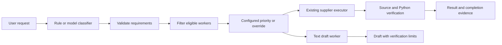

# Product foundation v1: providers, classifier and router

The first product milestone extends the existing supplier executor. It adds an
interchangeable provider contract, a configurable model registry, validated task
classification and a transparent router. It does not replace the supplier
workflow or frozen selective baseline. This is a deterministic routing baseline,
not a trained optimal selector or evidence of cost savings.

## One focused concept: eligibility before preference

A provider adapter translates one request into a particular service's API and
translates its response back. A classifier describes what the user needs. The
router first rejects workers that lack a required capability, availability or
budget; only then does it choose among eligible workers using configured priority.
The supplier executor still verifies extraction, arithmetic and feasibility.

For example, `code_generation` permits a code draft. It does not imply
`code_execution`. A model's declared tool support does not give Cortex an actual
reminder or GitHub tool. Such requests currently stop without claiming completion.
Similarly, a successful model HTTP response does not prove the task was completed.



## Files and boundaries

| File | Responsibility |
|---|---|
| `cortex/providers.py` | Ollama Chat, OpenAI Responses and Anthropic Messages adapters; safe structural errors; normalized text and usage |
| `cortex/registry.py` | Validated model IDs, task types, capabilities, provider settings, role assignments, optional availability probes and configured prices |
| `cortex/classifier.py` | Bounded deterministic supplier intent or small-model classification; strict validation; explicit clarification fallback |
| `cortex/routing.py` | Inspectable eligibility and priority rules; constrained model overrides |
| `cortex/product.py` | Shared usage ledger and budget; supplier wrapper/common extraction transport; text drafts and completion evidence |
| `cortex/product_cli.py`, `app_cli.py` | New `request` entry point alongside the original CLI; fresh result files and provenance |
| `config/cortex.example.json`, `.env.example` | Separate role/model configuration and environment variable reference |
| `tests/test_product_foundation.py` | 36 new checks, with mocked provider HTTP explicitly identified |
| `scripts/check_product_foundation.py` | Repeatable offline fixtures, mocked provider examples and previous-evidence preservation audit |

The only change to the old extraction gate admits the common-provider extractor
identity through the same existing validation. Domain parsing, engine actions,
arithmetic, budgets, selective policy and failure-aware policy are retained.
The original console entry point dispatches through `app_cli`; old invocation
syntax remains available. No third-party runtime dependencies were added.

## Setup and runnable commands

Python 3.10+ is supported; this checkpoint ran on 3.13.7. Run commands inside:

```powershell
Set-Location 'PATH_TO_YOUR_CHECKOUT\cortex-v1'
python -m cortex request --help
```

The default registry is `config/cortex.example.json` in this source checkout.
Use `--config` for a private customized copy. A separately installed wheel needs
an explicit configuration path; configuration is not packaged as Python data yet.

Deterministic classification and execution, without a provider call:

```powershell
python -m cortex request "Compare suppliers" --task examples/supplier_task.json --offline --max-model-calls 0 --output runs/my_product_offline.json
```

Expected: `completed`, Beta, total `11500`, 4 synthetic work units, 0 model calls,
0 reported tokens. Default recovery is `failure-aware`; choose
`--recovery-mode baseline` for the existing behavior. Existing modes are also
available directly through the original CLI.

Force AI classification while retaining deterministic supplier extraction:

```powershell
python -m cortex request "Compare suppliers" --task examples/supplier_task.json --classifier ai --probe-providers --max-model-calls 1 --output runs/my_product_ai.json
```

The example classifier is `qwen2.5:3b-instruct`; the example model worker is
`qwen2.5:7b-instruct`. Both were already installed locally. No model download was
performed. Model output can still fail classification validation or require
clarification; this command is not a guarantee of success.

Text generation with a separately selected worker:

```powershell
python -m cortex request "Draft a Python add(a,b) function returning their sum" --worker-model local-worker --probe-providers --max-model-calls 2 --output runs/my_code_draft.json
```

Expected scope: `drafted`, with no claim of code execution or semantic validation.
The classifier and worker share the two-call cap. Unknown or mixed tasks may stop
for clarification or planning instead of returning a draft.

Common-provider extraction using the existing bounded plain-text/source gate:

```powershell
python -m cortex request "Compare suppliers" --task examples/plain_text_quotes.json --extraction-mode parser-first --worker-model local-worker --max-model-calls 1 --output runs/my_common_extraction.json
```

An explicit worker override forces that registered eligible model, even for
structured source; it cannot bypass capability, availability or budget checks.
Without an override, parser-first selects the parser for structured JSON/CSV and
an eligible model for bounded plain text. Parser-only keeps the existing flexible
JSON/CSV/alias parser. The common extraction transport was checked with mocked
responses for all three providers; no live common-extractor trial was run in this
milestone. Earlier legacy Ollama extraction runs remain separate evidence.

Cloud setup uses private process environment values:

```powershell
# Set these privately; never paste real keys into saved commands, configs or logs.
# OPENAI_API_KEY and CORTEX_OPENAI_MODEL, or
# ANTHROPIC_API_KEY and CORTEX_ANTHROPIC_MODEL
python -m cortex request "Compare suppliers" --task examples/supplier_task.json --classifier ai --classifier-model openai-configured --max-model-calls 1 --output runs/my_openai_classification.json
python -m cortex request "Compare suppliers" --task examples/supplier_task.json --worker-model anthropic-configured --max-model-calls 1 --output runs/my_anthropic_extraction.json
```

Choose an account-accessible model supporting the advertised schema features;
the example's cloud identifiers are environment placeholders, not vendor-wide
competence assumptions. `roles.classifier`, `roles.planner` and `roles.worker`
are independent registry IDs; classifier, planner and worker CLI overrides are
independent too. Separate registry entries may reference the same provider model
or distinct ones. Planner configuration is stored but not invoked yet.

Cortex reads environment variables directly. It does not load `.env.example`
or `.env` automatically. Raw credentials are prohibited in registry settings.
Cloud endpoints are restricted to official APIs, and known credentials are
redacted from saved responses. Do not put confidential material in public traces:
requests and source-derived results are intentionally preserved as evidence.

## Classification, fallback and routing behavior

The classification has five fields: task type (analysis, coding, documents,
scheduling or mixed), required capabilities, missing essential information,
decomposition needed, and uncertain. Unknown fields, confidence scores, wrong
types, unsupported capabilities and inconsistent task-family requirements are
rejected. An uncertainty flag is not a calibrated probability.

`auto` recognizes a narrow complete supplier-comparison intent without a call.
Other requests use the configured classifier. `rules` accepts only that supported
intent and asks for clarification otherwise. `ai` always attempts the eligible
configured classifier. Invalid, unavailable or uncertain classification leads to
an explicit clarification result; it never silently executes an alternate model.
Budget exhaustion is a separate terminal status.

A sole missing-information sentinel `"none"` or `"no missing information"` becomes
an empty list. The original model proposal and normalization are recorded. Mixed
sentinels and actual missing items are rejected. This rule never fills missing
quote values. The existing quote gate handles missing shipping and aliases.

A bounded supplier comparison with a validated supplier attachment may route to
the specialized supplier worker even if AI classification lists broad `analysis`.
This context binding is an explicit trace rule. A generic analysis request with
an attachment does not automatically become a supplier comparison.

Every candidate's eligibility/rejections, model declaration, availability,
remaining budget and final reason are recorded. Models use configured priority,
not guessed vendor specialties or inferred prices. Deterministic supplier parsing
normally takes precedence. An unavailable override stops; it never switches
providers. Without a probe, availability means configured, not connected.
`--probe-providers` performs bounded metadata requests, without consuming inference
call limits. Inventories may be paginated or omit aliases; a missing listing is a
conservative rejection, not proof that the model cannot be used. A listing does
not establish competence. Runtime failures still terminate explicitly.

## Usage and termination

All actual inference attempts in the new classifier and worker path share the
existing model-call limit. The counter is reserved immediately before HTTP and
includes failed attempts. Configuration failure or pre-call budget rejection uses
zero calls. There are no automatic provider retries, and provider failure never
becomes silent local fallback. Structural HTTP status/type determines diagnosis;
exception-message text is not used to classify failures.

An AI classification and a text draft each cost one **synthetic work unit**.
Supplier actions retain their old weights. Classification/routing rules cost zero.
Router admission reserves only enough for the first supplier action; the existing
engine checks each later action, recovery and verification budget. This retains
low-budget missing-information clarification and the one-retry timeout boundary.

The top-level `model_usage` is the complete new-path ledger. Nested supplier
`model_usage` covers its execution phase only, while its shared budget counter may
also include the preceding classifier call. Do not sum nested and top-level usage.
Provider input/output telemetry is preserved, with unavailable counts `null`, not
zero. With no inference calls, totals are zero. Anthropic ordinary input counts
exclude cache reads/creation; normalized total input includes all three only when
all are reported. OpenAI total input already includes cached input. Cached counts
are retained separately; output includes provider-reported reasoning usage where
included by the provider. A timeout can consume unreported server work.

Pricing is configurable per million ordinary input, output, cache-read and
cache-creation tokens. Omitted prices remain `null`. This milestone does not
compute invoices or enforce a dollar/token budget: it enforces synthetic work and
inference-attempt caps. `money_usd` remains unknown. Timings are local elapsed
measurements, affected by loading, queuing and machine state; they are not a
controlled latency comparison. Prompt hashes, versions, requested/reported model
IDs, source/config hashes, role, outcome and failure category are recorded.

## Checks and saved evidence

```powershell
$env:TMPDIR = "$PWD\.test_tmp"
python -m compileall -q cortex tests scripts
python -m unittest discover -s tests -q
python scripts/verify_selective_baseline.py
python scripts/verify_extraction_evidence.py
python scripts/check_product_foundation.py --output-dir runs/my_foundation_checks
```

All **143 tests passed**, including the original 107 and 36 new checks. New tests
cover all provider wire/response/error contracts, unknown usage/cache accounting,
credential redaction, classification validation and uncertainty, role separation,
candidate capabilities/availability, overrides, shared budgets, supplier recovery
and completion evidence. Provider HTTP in tests is mocked. Compilation passed.
The frozen selective differential matches six cases including planning, with
exact model payloads, actions, results, budgets and tokens. The extraction evidence
audit passed for 216 saved development runs.

`runs/product_foundation_v1_final_offline_mocked_v2/` holds seven deterministic
examples (normal, one-time timeout, persistent timeout, arithmetic repair, missing
shipping, alias and zero work budget), plus explicitly mocked two-call
classifier/extractor examples for Ollama, OpenAI and Anthropic. Mock token counts
are artificial fixture telemetry, not actual consumption. All 379 previous run
files and the previous experiment-log prefix were preserved byte for byte.

Actual Ollama evidence is in `runs/product_foundation_v1_live_summary.json` and
the referenced individual files. `live_environment.json` records Ollama 0.31.2,
installed model digests and only credential-presence booleans. There were seven
actual inference attempts across six development executions:

| Live execution | Outcome | Calls | Input/output tokens | Synthetic units | Elapsed ms |
|---|---|---:|---:|---:|---:|
| Classifier v1 | Incorrect missing-input clarification | 1 | 368 / 54 | 1 | 7585.62 |
| Classifier v2 | Rejected internal classification capability; old status diagnosis misleading | 1 | 460 / 51 | 1 | 1677.92 |
| Classifier v3 | Broad analysis classification; old supplier binding missing | 1 | 475 / 42 | 1 | 1654.19 |
| Supplier route v1 | `none` sentinel triggered old clarification behavior | 1 | 475 / 57 | 1 | 1709.01 |
| Code draft | AI classification → qwen 7B draft; not executed | 2 | 541 / 239 | 2 | 22435.86 |
| Verified supplier | AI classification → parser → Beta 11500, verification passed | 1 | 475 / 46 | 5 | 6475.06 |

These were sequential diagnostic edits, not comparable independent benchmark
trials. Failures are retained with their original status, hashes and traces. The
current code fixes the misleading no-worker/budget diagnosis, excludes internal
classification from task requirements, binds bounded supplier context and
normalizes the sole sentinel. Prompt versions v1–v3 were explored manually;
there was no automatic refinement loop. The last supplier response had an actual
empty missing list, so it does not constitute a live test of sentinel normalization.
Intermediate source archives v2/v3 exist; hashes are recorded for all runs, but
not every intermediate source revision has a complete standalone archive.

Both cloud credentials were absent. OpenAI and Anthropic are implemented adapters
with mocked contract/classifier/extraction coverage, **not live-validated cloud
integrations**. Local connectivity needed the host network permission boundary.
Tests used a project-local temporary directory because the default Windows temp
path was denied. Python emitted a launcher-path warning while completing checks.
A manual CLI smoke check found an arrow character in help text that failed on
Windows cp1252 output. Help now uses ASCII arrows, with an encoding regression
test; the failed smoke-check output is retained as development evidence.

## Preservation and next work

Before edits, `snapshots/pre_product_foundation_v1.zip` captured 415 source,
documentation and evidence files. Its SHA-256 is
`1ffb2cab435b51991621af7e11b22ebd00ad3018d61d00a8100fbebf266045c1`.
The selective, failure-recovery and heterogeneous-extraction checkpoints remain
unchanged. The final product source/evidence is frozen separately as
`snapshots/product_foundation_v1_checkpoint.zip`; its checksum is saved beside it.

This foundation is ready for structured planning and prompt construction next.
Decomposition currently returns `needs_planning`, with `planner_invoked: false`.
Persistent task/resume state, bounded semantic refinement, document file creation,
actual reminders, GitHub actions, browser UI, deployment and submission assets
remain subsequent milestones. Code text is a draft; supplier verification is
bounded by the existing parser and excerpt gate. Neither model confidence nor
excerpt presence proves interpretation. No general reliability, trained novelty,
calibrated uncertainty or economic savings are established by these checks.

API contracts were checked against the official [Ollama Chat documentation](https://docs.ollama.com/api/chat),
[OpenAI Responses structured outputs](https://developers.openai.com/api/docs/guides/structured-outputs?api-mode=responses)
and [Anthropic Messages documentation](https://platform.claude.com/docs/en/api/messages/create).
Cache accounting follows [Anthropic's reported usage definitions](https://platform.claude.com/docs/en/build-with-claude/prompt-caching).
